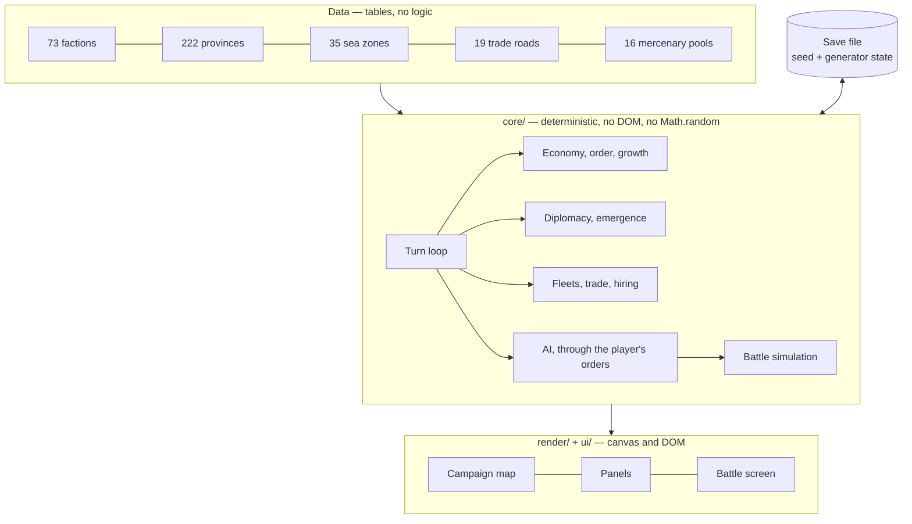

<div align="center">


# Regna: Age of Kingdoms

**A turn-based grand strategy game with real-time battles. Europe, the Mediterranean and the Near East, 1080 to 1530. Seventy-three historical powers, and not one of them invented.**

[](LICENSE)
[](https://www.typescriptlang.org)
[](https://vite.dev)
[](#development)
[](#architecture)

[Why](#why-regna) · [The world](#the-world) · [Features](#features) · [How it works](#how-it-works) · [Quick start](#quick-start) · [Playing](#playing) · [Architecture](#architecture) · [Roadmap](#roadmap)

</div>

---

## Why Regna

Grand strategy games set in the Middle Ages tend to offer the same twenty or so
powers: England, France, the Empire, Byzantium, the Turks, and whichever
Italian republics the map has room for. Everyone else is scenery, a grey
province waiting to be annexed by somebody with a name.

But the period was crowded. In 1080 the Kingdom of Croatia had a crowned king
at Knin, Ragusa was a republic with its own senate, the Cumans held the lower
Danube, Ghana was the richest state in the western world, and a Christian
kingdom on the middle Nile had fought Arab armies to a standstill and then kept
the peace by treaty for six hundred years.

Regna gives all of them a seat. **Seventy-three factions**, every one a real
polity with its own troops, its own faith and its own quarrel with its
neighbours. Nothing is backdated: a state that did not exist in 1080 enters
play in the year it actually rose, at the place it rose from.

<div align="center">

</div>

## The world

| | |
| :--- | ---: |
| Factions | **73** |
| Provinces | **222**, each at its settlement's real coordinates |
| Sea zones | **35**, from the Norwegian Sea to the Niger |
| Trade roads | **19**, from the Silk Road to the English wool trade |
| Mercenary pools | **16**, each in the country that bred the company |
| Unit types | **91** land, **13** ships, **8** hire-only companies |
| Buildings | **39**, in 13 upgrade chains |
| Campaign | 1080 to 1530, two turns to the year |

## Features

- **A map with two layers.** Provinces are the land; sea zones are the water. A
  harbour opens onto one or more zones, and fleets move from zone to zone. Great
  rivers are zones too, because the Nile, the Danube, the Dnieper, the Volga and
  the Rhine carried more medieval traffic than most coastlines.

- **One battle model, two presentations.** The battle you watch and the battle
  the campaign resolves without you are the same simulation at the same
  timestep. There is no separate auto-resolve formula, so the odds you are shown
  are the odds that actually apply.

  | | |
  | :--- | :--- |
  | Melee | attack against defence, modified by experience, fatigue, slope and ability; a shield counts only against the front and left |
  | Flanks | a hit from the flank or rear is nearly twice as bad, and being outnumbered in contact worse again |
  | Missiles | fall off with range, blunted by armour, and run out — nobody resupplies in the field |
  | Morale | shock from casualties, from being shot at, from a flank attack, and from watching the regiment beside you break |
  | Ground | hills and mountains fight on a ridge, and holding the crest is worth real advantage |

- **Trade is a wager, not an allowance.** A trade road is an ordered path of
  real provinces. Sending a caravan costs money now and pays more on arrival,
  less a toll to every lord whose land it crosses. War shuts a road rather than
  taxing it, and an army standing where a caravan stands takes the whole cargo.

- **Fleets, blockade and invasion.** A squadron standing between two harbours
  closes the trade along that lane and stops an army crossing it. Shutting a
  harbour outright needs every approach closed, which is why Constantinople with
  three seas in front of it is so much harder to invest than Zadar with one.
  Keep a fleet at sea through the winter and the gales will take hulls from it.

- **Mercenaries are found, not raised.** A company exists in the country that
  bred it, in limited numbers. Hiring one ignores your own roster entirely and
  denies it to everyone else until the country furnishes another. It joins at
  once, costs nearly twice a levy to keep, and is the first thing to leave when
  the pay stops.

- **An economy that behaves like a medieval one.** Population grows logistically
  towards what the land can feed. A realm pays for its buildings, its soldiers,
  its administration, and its hoard, because money in a vault was spent on
  display, siphoned by the officials guarding it, or quietly debased.

- **One order layer.** Every button calls the same function the AI calls. The AI
  cannot do anything you cannot, and anything it cannot do is a missing order
  rather than a cheat.

- **Deterministic from a seed.** The same seed and the same orders always
  produce the same campaign and the same battle, which is what makes save games
  exact and the simulation testable.

<div align="center">

</div>

## How it works



A turn runs a fixed pipeline: the AI acts, sieges progress, provinces build and
muster and grow and settle or revolt, fleets and caravans move, finances settle,
the clock advances, new factions emerge, dead ones are reaped, and every army
and fleet gets its movement back. The order is fixed so that a save taken at any
point replays identically.

## Quick start

Prerequisites: [Node 20+](https://nodejs.org). Nothing else — the game has no
runtime dependencies.

```bash
git clone https://github.com/Hercegman/regna.git
cd regna
npm install
npm run dev          # http://localhost:5173
```

## Playing

Choose a faction, then:

| Action | How |
| :--- | :--- |
| Select a province | click it |
| See a sea and the fleets in it | click open water |
| Pan and zoom | drag, scroll |
| Every province name | `L` |
| Every trade road | `T` |
| End the turn | `Enter` |

The panel on the right has the province, its building, recruitment and
shipbuilding options, the trade roads through it, diplomacy and the state of the
realm.

- **On land.** Select an army, press **March**, click a highlighted province.
  Moving into a defended enemy province offers battle, which you can fight
  yourself or leave to your captains. A walled settlement has to be stormed or
  starved out.
- **At sea.** Lay down hulls from the **Ships** tab, select the squadron, press
  **Sail**, then click a water or a harbour. Load an army with **Embark** and
  put it on a hostile coast with **Land at**.
- **On the roads.** The **Trade** tab shows what a caravan would cost and what
  it is expected to fetch, and sends one.
- **For hire.** Companies appear on the province panel wherever any are standing
  about, including in towns you do not own.

**Save** stores the campaign in the browser; **Export** downloads it as a file.
Both are offered again on the faction select screen.

<div align="center">

</div>

## Architecture

| Layer | What it does |
| :--- | :--- |
| `src/core/data/` | Factions, units, ships, mercenaries, buildings, provinces, borders, seas, trade roads. Tables, with no logic in them. |
| `src/core/campaign/` | The turn loop, economy, public order, recruitment, diplomacy, faction emergence, the navy, trade, hiring, the AI, and saves. |
| `src/core/battle/` | Deployment, the fixed-timestep simulation, the battle AI and the ground. |
| `src/render/` | The Mercator projection and camera, the campaign map, the battlefield. |
| `src/ui/` | Screens, panels, persistence. Plain DOM, no framework. |
| `tests/` | 199 tests, including three-hundred-turn runs that assert the simulation never breaks its own rules. |

Nothing in `src/core/` touches the DOM or calls `Math.random`. Randomness comes
from a xoshiro128\*\* generator whose state is saved with the campaign, which is
why a reloaded save continues identically to one that was never saved — a
property the tests check by playing both forward fifteen turns and comparing.

### Extending it

Adding a faction is one entry in `factions.ts`, plus one line in
`EMERGENCE_SEATS` if it enters play after 1080. Adding a province is one row in
`regions.ts` and its borders in `adjacency.ts`; if it has a harbour, add it to a
sea zone. The tests will tell you if the result is inconsistent: they assert
that every faction can field melee, ranged, cavalry and siege troops, that the
map is fully reachable, that sea crossings join two harbours, that the island
landmasses are exactly the expected ones, that every harbour has water to sail
into, that every trade road is contiguous, and that a hull is never found in an
army or standing on a town wall.

## Development

```bash
npm test             # vitest
npm run typecheck    # tsc --noEmit, strict
npm run build        # typecheck, then bundle
```

URL parameters open a known state without a sequence of clicks:

```
?faction=croatia&turns=60&tab=trade      a campaign already sixty turns in
?demo=battle&at=255                      a land battle four minutes in
?demo=sea&play=1                         a sea fight, running
```

## Roadmap

- [ ] End the campaign in 1530, with a reckoning rather than silence
- [ ] The Papacy as a political force: crusades, excommunication, the interdict
- [ ] Agents — spies, envoys, priests and merchants
- [ ] Dynasties: marriage, legitimacy, and a disputed succession worth fighting
- [ ] An opening tutorial, because the interface is dense and says nothing
- [ ] Mercenary politics: companies that change sides, or take a city instead of a contract

## Not a reimplementation

Regna is written from scratch. It is not a port, a decompilation or a
reimplementation of any existing game: no commercial binary was disassembled,
and no third-party game data, art or text is included. The genre is the
inspiration; the code, the data and the prose are this project's own.

Historical facts are not copyrightable, and the entire world — the polities, the
settlements, the units, the roads, the dates — is built from them. See
[`docs/history.md`](docs/history.md) for which way every disagreement between the
game and the record was settled, and [`docs/design.md`](docs/design.md) for how
the simulation fits together.

## License

[MIT](LICENSE).
