<div align="center">

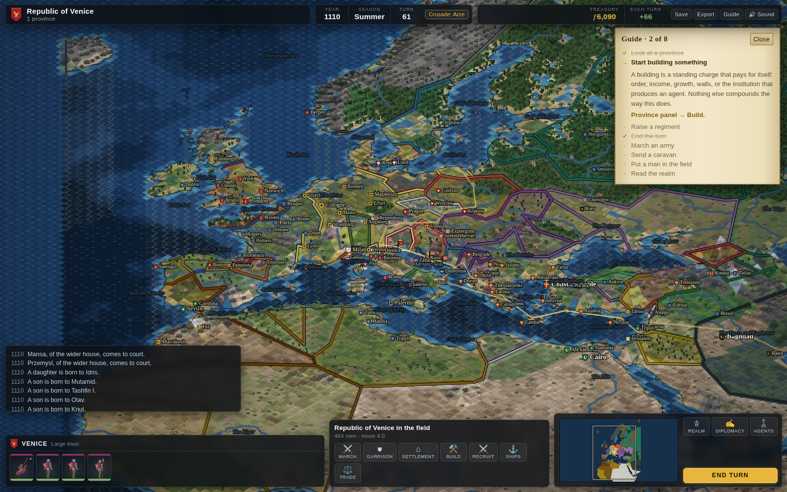

# Regna: Age of Kingdoms

**A turn-based grand strategy game with real-time battles. Europe, the Mediterranean and the Near East, 1080 to 1530. Seventy-three historical powers, and not one of them invented.**

[](LICENSE)
[](https://www.typescriptlang.org)
[](https://vite.dev)
[](#development)
[](#architecture)

[Why](#why-regna) · [The world](#the-world) · [Features](#features) · [How it works](#how-it-works) · [Quick start](#quick-start) · [Playing](#playing) · [Architecture](#architecture) · [Roadmap](#roadmap)

</div>

---

## Why Regna

Grand strategy games set in the Middle Ages tend to offer the same twenty or so
powers: England, France, the Empire, Byzantium, the Turks, and whichever
Italian republics the map has room for. Everyone else is scenery, a grey
province waiting to be annexed by somebody with a name.

But the period was crowded. In 1080 the Kingdom of Croatia had a crowned king
at Knin, Ragusa was a republic with its own senate, the Cumans held the lower
Danube, Ghana was the richest state in the western world, and a Christian
kingdom on the middle Nile had fought Arab armies to a standstill and then kept
the peace by treaty for six hundred years.

Regna gives all of them a seat. **Seventy-three factions**, every one a real
polity with its own troops, its own faith and its own quarrel with its
neighbours. Nothing is backdated: a state that did not exist in 1080 enters
play in the year it actually rose, at the place it rose from.

<div align="center">
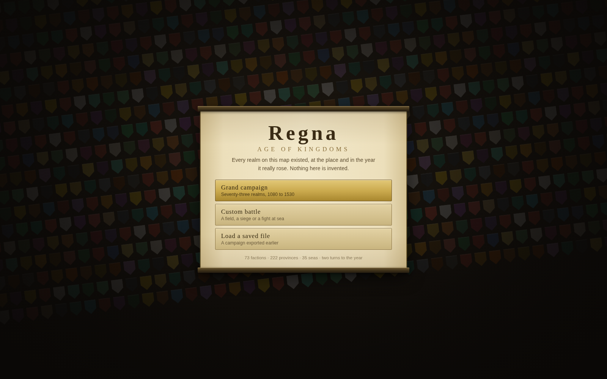
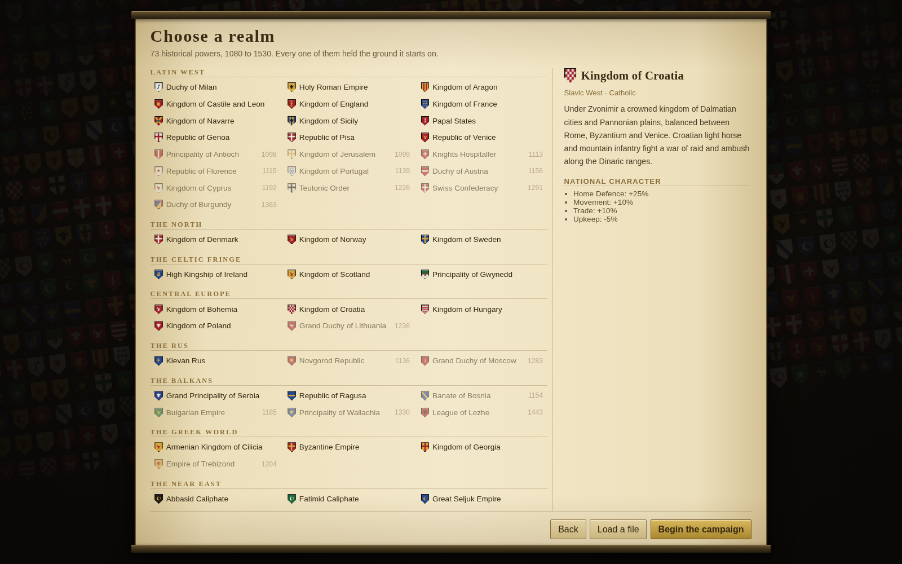
</div>

The front of the game is a wall of their shields with a sheet of parchment laid
on it. From there: a grand campaign, a campaign already in progress, a saved
file, or one battle fought on its own — a field, an assault on a town, or a
fight at sea.

## The world

| | |
| :--- | ---: |
| Factions | **73** |
| Provinces | **222**, each at its settlement's real coordinates |
| Sea zones | **35**, from the Norwegian Sea to the Niger |
| Trade roads | **19**, from the Silk Road to the English wool trade |
| Mercenary pools | **16**, each in the country that bred the company |
| Sacred places | **33**, claimed by one faith or contested by two |
| Unit types | **91** land, **13** ships, **8** hire-only companies |
| Buildings | **39**, in 13 upgrade chains |
| Campaign | 1080 to 1530, two turns to the year |

## Features

- **Isometric pixel art, the way it was actually made.** The map is a grid of
  diamond tiles of real ground — ETOPO elevation from NOAA, public domain —
  each raised by the height under it, on a real coastline from Natural Earth.
  Everything standing on it was modelled in Blender and rendered from the one
  camera angle the tiles allow, then shrunk fourfold and snapped to a short
  palette. The pixels are what came out of that rather than what went into it,
  which is how Transport Tycoon and Locomotion were made and why they look the
  way they do.

  | | |
  | :--- | :--- |
  | The grid | runs diagonally through longitude and latitude, so the tiles come out diamond and Europe stays the way up it has always been — laid along the world's own axes it would put north in a corner |
  | Height | quantised into hundred-metre steps and exaggerated, because the Alps are four kilometres tall and five hundred wide and at true scale a continent is a sheet of paper |
  | The ground | read from an averaged copy of the elevation whose posts are about as far apart as a tile is wide, or a mountain range becomes a field of spikes |
  | Provinces | divided by a Voronoi diagram of the settlements, computed by half-plane clipping and cached |
  | The ground | mottled from the tile's own coordinates and dressed with what grows on it — woods, worked fields with the furrows in them, scrub, boulders — so a plain is a plain and not a sheet of one green |
  | Places in it | what grows where is asked at a coarser grain than a tile and smoothed between the answers, so the dressing comes out in stands and clearings instead of scattered one to a tile at the same thinness everywhere. The ground's own colour follows the same patches, so the dark going is the going with the trees in it |
  | Ploughland | belongs to the field and not to the tile: a block of tiles ploughed one way, the next block across it, and an unploughed baulk between them with whatever grew in it. Fixed to the tile, every tile turned its own way and a mile of farmland averaged out into one grey hatch |
  | Height | has the last word on the ground: above the treeline it is bare rock and above that snow, and the line wanders, because one drawn straight across a continent is a contour and not a treeline |
  | The shore | a shelf of pale water wherever the sea touches land, a strand of sand wherever the land touches sea, and the real Natural Earth coast drawn over the join |
  | Rivers | the great ones, drawn: the Rhine, the Danube, the Dnieper, the Volga, the Nile. A river is the strongest line in a landscape and the eye finds everything else from it |
  | Frontiers | chained into continuous runs before they are stroked, so a corner is a corner, and the whole lot drawn on its own plate and cut to the coastline — a border running across open water is the one thing that most gives away a map drawn from a diagram |
  | Arms | every realm bears its own, drawn from a blazon rather than loaded from a folder of pictures: beside the name of every town it holds, on the banner over every army it has in the field, on its crest in the chrome, and on the wall of shields at the front of the game |
  | Texture | each tile takes a handful of marks a shade either side of its own colour, in places fixed to its coordinates — six fills a tile, and the whole difference between ground you read and a chart you look at |
  | Shadows | everything standing on the ground throws its own shape, sheared over and pressed flat — a man with his shield up throws a shadow with the shield in it. The shear is baked into the sprite once at each size, so laying a shadow down costs what drawing the man costs, which matters when the frame holds two thousand of them |
  | Ownership | a weak wash on the tile tops, a band of the owner's colour laid inside his own frontier, and his shield beside the name of every town he holds — because the first question anyone asks of a map like this is whose |
  | Settlements | sized against the zoom and not against the tile, so a town covers a fixed piece of ground: pull back and Verona is a mark on Italy rather than a model sitting on top of it |
  | Position | every sprite records where its own model stood, and is stamped by that point rather than by the middle of its frame — so a town lands on its coordinates and a spear leaning out of the frame does not move the settlement carrying it |
  | Armies | the man in command. An army with a general is a horseman with his standard planted beside him, one without is a captain on foot; either way what is standing in the province is a person, not a counter |
  | Sprites | one sheet; anything belonging to an owner is rendered in magenta and swapped for his colour, which is how one drawing serves seventy-three realms. The magenta is lit rather than flat — green stays at nought while red and blue carry how brightly that face was lit — so what is swapped in is the realm's colour standing in the light the rest of the model was standing in, and a surcoat has a shoulder and a flank instead of being a rectangle of paint |
  | The figure | a skeleton, not a stack of boxes: hip, knee, ankle, shoulder, elbow, wrist, a pelvis, a tapered chest and a round head on proportions a person actually has. Every pose is a table of the angles those joints take, so the knees fold in a stride and the elbow comes up in a lunge. At twenty pixels you cannot see a knee; you can see that the leg has one |
  | The walk | four beats out of four pictures — step, pass, other step, pass. The pass is the leg that has swung through coming under the body with the knee up, and it is the frame the sheet did not have: with straight legs a stand will serve for it, and with a knee in them it will not. A line standing still shifts its weight too, a man at a time, because a hundred identical frozen figures read as a texture |
  | What he carries | placed in the hand that is holding it rather than at a fixed point beside him, so a spear comes up and across as the arm that owns it does, and a couched lance is tucked under the elbow it is actually tucked under |
  | Shrinking | a ninety-pixel model becomes a twenty-pixel man by averaging, not by keeping one pixel in five. Nearest-neighbour decided whether a four-pixel limb survived by where the grid happened to fall, and the grid moves every time the camera does, which is how men used to arrive on the field with one arm. The alpha is hardened again afterwards and the outermost ring darkened, which gives every figure the line between it and the grass that it needs |
  | Battles | the same picture at the scale of one field — pulled back a regiment is a body of men under a standard, closed in it is the men themselves in their ranks and files |
  | Names | drawn afterwards at the screen's own resolution, because a place name in six-pixel type is not a style, it is unreadable — and on the town it belongs to, which means the town is stamped at its own coordinates rather than at the middle of whichever tile it fell in |

- **Instruments over the world, and paper for reading.** The map is the whole
  screen and the chrome floats on it: a panel at the top for the realm, the
  calendar and the treasury; panels along the bottom for the men and the
  orders — every regiment as a card with its own soldier on it in its own
  colours, its strength under it and its experience in the corner; the radar
  in the corner, which is flat and north-up because a small isometric map is
  unreadable and a small flat one with the countries painted in is a map of
  Europe. All of it is dark glass with a hairline of light on it and one
  amber that means *this is live*, because a frame around the picture is a
  thing that says the picture stops here, and it does not: the ground runs
  under the panels and out to every edge.

  What is for reading rather than for watching is still paper. A parchment
  unrolls over the map when there is a province to go through or an order of
  battle to read, and rolls away when there is not — a dossier is a different
  act from a glance at a gauge, and it should not look like one.

  The battlefield wears the same instruments, because it is the same game. What
  differs is what a card has to say: in a battle a regiment is men who are also
  tired and frightened, so the card carries heart as well as strength, and the
  radar shades the ground by height — which is the one thing about a
  battlefield that decides battles and the one thing a picture taken from the
  side will not show you.

  Everything written rather than ordered is on paper: the province and its
  works, the other crowns, the roads, the house, the faith, the front of the
  game and the reckoning at the end of it. One sheet, unrolled over the map
  and rolled away again.

  <div align="center">
  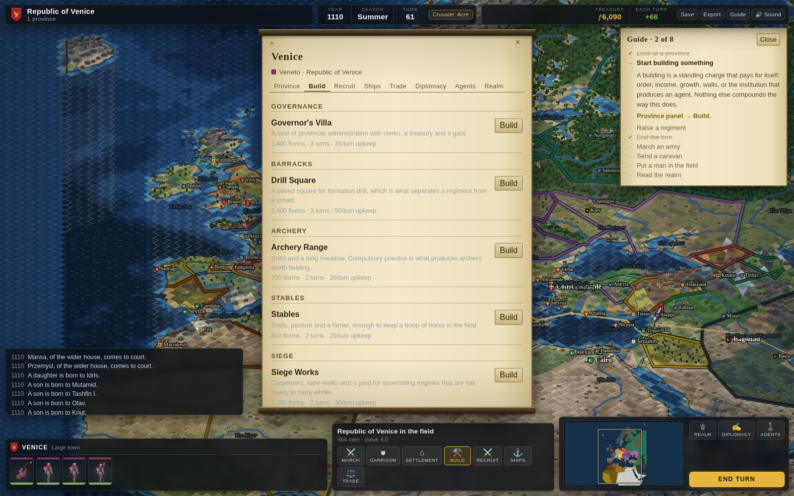 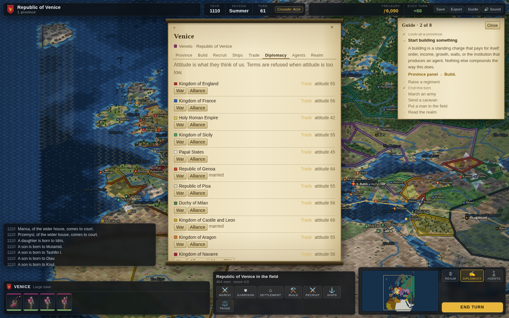
  </div>

- **A map with two layers.** Provinces are the land; sea zones are the water. A
  harbour opens onto one or more zones, and fleets move from zone to zone. Great
  rivers are zones too, because the Nile, the Danube, the Dnieper, the Volga and
  the Rhine carried more medieval traffic than most coastlines.

- **Every man, and the right man.** The figures are modelled and rendered the
  same way the towns are: legs apart, a torso in his lord's colours, arms, a
  helmet, and whatever he is actually carrying. A spearman has a spear and a
  shield, a pikeman a pike twice his height, an archer a stave and a quiver and
  no shield at all, a crossbowman his bow held level across the chest, a knight
  a barded horse and a couched lance with a pennon on it. The simulation always
  knew which of them a regiment was made of; now so does the picture.

  A regiment is the men in it at every zoom the camera will give you, in ranks,
  each rank offset by a share of his own height so the ranks read as ranks. Over
  each one stands its realm's banner, in its real arms, because that is what a
  medieval battlefield was read by. Behind each one lie its dead, a mark a man.

- **And they move.** Every kind of soldier is rendered facing eight ways and in
  six poses, so a line faces the line it is fighting — at whatever angle it
  happens to be fighting it — and marches on its own legs: step, stand, other step, stand, with every man on his own beat so a
  block on the move is a crowd out of step rather than a chorus line. In contact
  the front rank swings and leans into it while the ranks behind stand and wait,
  which is what the ranks behind were actually doing. A spear comes down to the
  level, a pike comes down to a hedge, an archer draws, a crossbowman brings his
  bow to the shoulder, a lance drops into the couch. The cloth on every standard
  waves. Nothing is a loop played at the picture: it is all read off the state
  the simulation is in this tick, so a regiment that stops moving stops walking.
  When a regiment breaks, its men run: a longer stride, arms up, and nothing
  in their hands, because the shield and the spear are the first things a man
  throws away — which is the one thing that reads as a rout rather than as a
  march in the wrong direction.

  And when a man is hit he goes down over a second rather than blinking out of
  standing and into lying on his back: two frames of falling, pitched the way he
  was facing, sized down from a standing man to a body. He has dropped his
  shield and his weapon on the way, which is why there is one falling figure
  rather than one for every kind of soldier — and why a knight comes off his
  horse. Then he stays exactly where he fell, for the rest of the day. The dead
  used to be a scatter pinned to the regiment that had lost them, so a regiment
  dragged its own dead across the field behind it and took them away when it
  marched off; now the simulation writes down each man as it kills him and the
  ground a fight was had on keeps them.

  A siege train is machines rather than ranks. Two silhouettes cover the five
  kinds — a frame with a throwing arm for the ballista, the catapult and the
  trebuchet, a barrel on a timber bed for the bombard and the culverin — one
  engine to a dozen crew, each with its own gunners in the sprite, and a muzzle
  flash on the gun that has just gone off. Until the sheet had either of them,
  every engine on the field was drawn as a swordsman.

  <div align="center">
  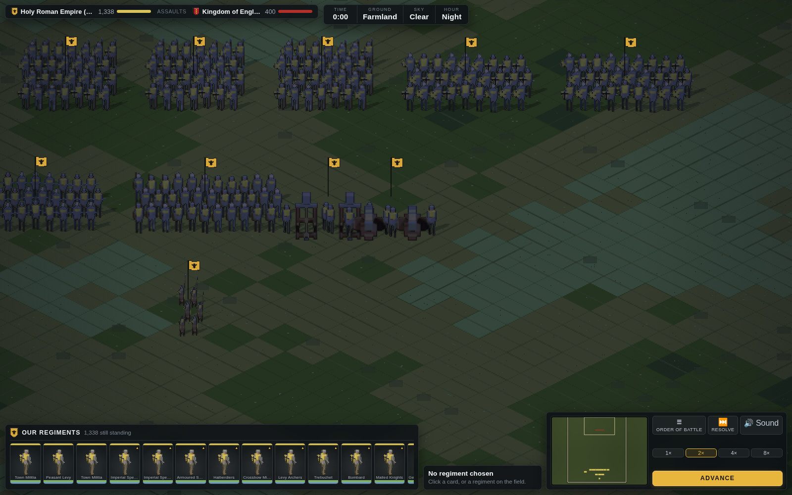
  </div>

  And no two men beside each other are the same man. Every kind is rendered in
  two kits — a surcoat of his lord's colours over a kite shield under a flat
  helm, or mail with a coloured band over a round shield under a conical one —
  and which a man wears is fixed to where he stands in his own block. Half a
  regiment mostly coloured and half mostly grey is the difference between a
  body of men and the same man stamped a hundred and twenty times.

  **Every man carries his realm's device on his shield.** Two marker colours
  rather than one: magenta for whatever belongs to the owner, cyan for what is
  painted on the board, and the second is swapped for the tincture that realm's
  own blazon puts there — the ordinary over the field, the other half of a
  divided one, whatever the charge is in. A black cross on Imperial gold, gold
  on French blue, white on Danish red. It costs no extra renders, because the
  division is in the model rather than in a variant of it, and it is the
  difference between seventy-three realms carrying the same flat board in
  different paint and seventy-three realms carrying their own.

  <div align="center">
  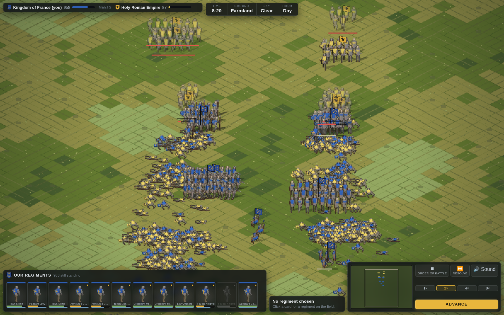
  </div>

- **One battle model, two presentations.** The battle you watch and the battle
  the campaign resolves without you are the same simulation at the same
  timestep. There is no separate auto-resolve formula, so the odds you are shown
  are the odds that actually apply.

  | | |
  | :--- | :--- |
  | Melee | attack against defence, modified by experience, fatigue, slope and ability; a shield counts only against the front and left |
  | Flanks | a hit from the flank or rear is nearly twice as bad, and being outnumbered in contact worse again |
  | Missiles | fall off with range, blunted by armour, and run out — nobody resupplies in the field |
  | Morale | shock from casualties, from being shot at, from a flank attack, and from watching the regiment beside you break |
  | Ground | hills and mountains fight on a ridge, and holding the crest is worth real advantage |
  | The sky | what is falling, and what hour it is — below |

- **Walls that are worth building.** The simulation had a settlement on the
  field from the first commit and never once read it, so storming a stone town
  was a field battle in which the defender happened to be a garrison. Two
  centuries of campaign said so: attackers took walled towns nine times in ten
  and paid no more for a wall than for an open field, which is the exact
  opposite of the medieval record.

  | | |
  | :--- | :--- |
  | The garrison | forms *inside* its own walls, and stays there — a line of battle is twice as wide as a town, so most of it used to stand outside the wall it was defending |
  | Defence | multiplied by the works, from a palisade to the greatest stone |
  | The ladder | the man coming over fights worse, and shot into the works is blunted |
  | Frontage | **the fight is as wide as the parapet and no wider.** A man on a wall is never flanked and never surrounded, and the attacker's numbers wait their turn. This is the wall; everything above it is arithmetic that enough men can drown |
  | The breach | only engines bring a wall down, and an army without a siege train can stand in front of a stone town all day |

  At two to one against a small garrison: six regiments take an open town every
  time, a wooden one about half the time, and a stone one not at all — and with
  two trebuchets they take the stone one every time. The trebuchet finally earns
  the road it was dragged along.

  <div align="center">
  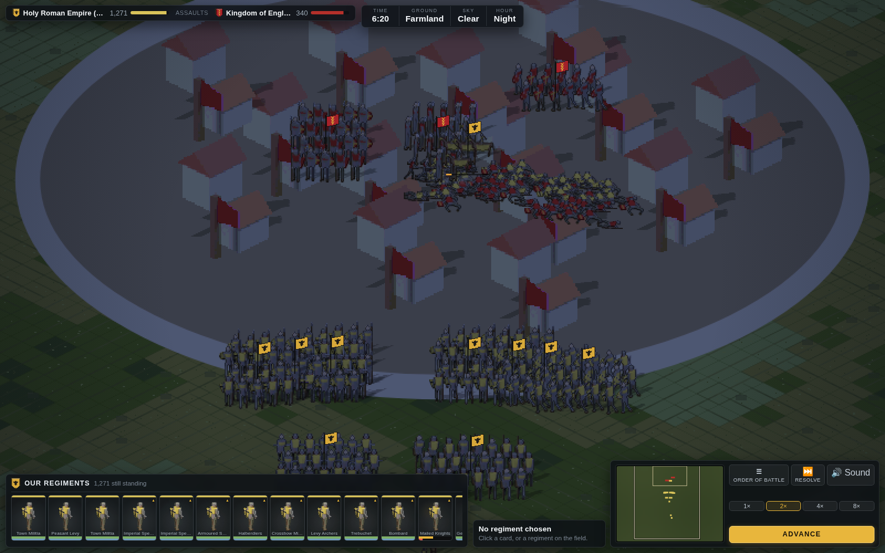
  </div>

- **Fought in whatever the morning gave.** Six skies — clear, overcast, rain,
  storm, snow, fog — and four hours, rolled once from the battle's own seed so a
  replayed campaign fights the same battle under the same sky. None of it is a
  filter over the picture: every number the weather sets is read by the
  simulation, and the fog that thins the field is the fog that stopped the
  archers shooting. And the day does not hold still: about two battles in five
  see the sky turn, to a neighbouring one rather than an arbitrary one, crossing
  over half a minute rather than cutting — cloud thickens into rain, a storm
  blows itself out, fog lifts. Snow lies on the ground as well as falling
  through the air.

  | | |
  | :--- | :--- |
  | Sight | caps missile range and target selection. Fog closes a field to about a hundred metres, short of a longbow's reach, so an army in it is on top of you before anyone has shot |
  | Bowstrings | a wet string loses its cast, and poor light costs the aiming |
  | Powder | rain does not hinder a gun, it stops it — which is what happened to the Genoese at Crecy, and to every gun caught in the open for three centuries after |
  | Footing | mud and snow, and cavalry suffers half again more than foot does |
  | Toil | men tire faster in snow, in storm, and under a desert sun |
  | Nerve | standing in the dark in the rain waiting to be charged by something you cannot see is its own argument for going home |
  | The light | a battle begun at dusk has about eleven minutes of day left. After that the defender keeps the ground he is standing on, and the attacker needed a clear win rather than a narrow one |

  <div align="center">
  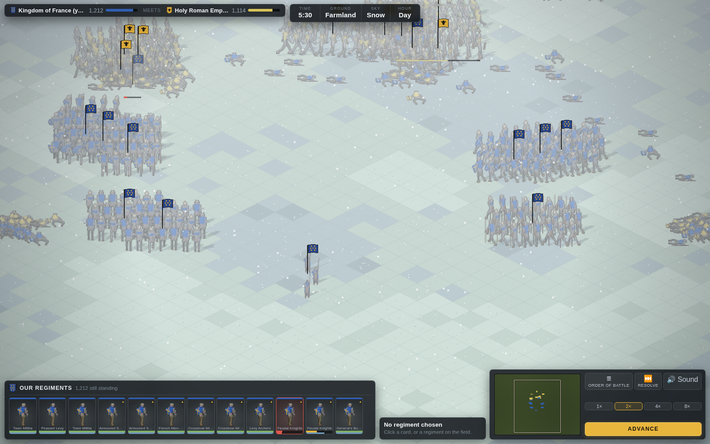 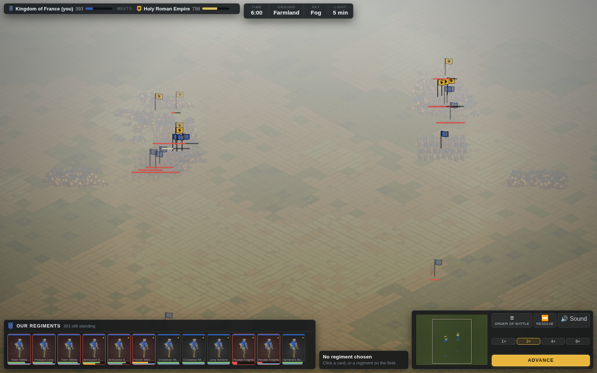
  </div>

  The battle AI is under the same limits. It cannot shoot what it cannot see,
  and in fog its cavalry stops picking the exposed flank out of a line and
  charges whatever is nearest — which is how cavalry was wasted on nights like
  Barnet. Snow stays out of a summer campaign and out of the desert, fog
  thickens on marsh and coast, fleets do not fight in the dark, and a night
  attack is four times likelier against a wall, because the dark is most of
  what a storming party had going for it.

- **Sound, made rather than recorded.** There is no audio file in this
  repository. A volley of arrows is filtered noise with a sweep on it, steel on
  a shield is a noise burst and a ring, a horn is three detuned saws through a
  low-pass, thunder is the same noise with the top taken off, and the bell at
  the end of a turn is three sine partials at a bell's own ratios. It follows
  the same rule the picture does: a volley is heard only where the simulation
  has a regiment shooting, the ring of steel runs at a rate set by the men
  actually in contact this tick, and a paused battle is silent — because a
  paused battle is a still picture.

- **Trade is a wager, not an allowance.** A trade road is an ordered path of
  real provinces. Sending a caravan costs money now and pays more on arrival,
  less a toll to every lord whose land it crosses. War shuts a road rather than
  taxing it, and an army standing where a caravan stands takes the whole cargo.

- **Fleets, blockade and invasion.** A squadron standing between two harbours
  closes the trade along that lane and stops an army crossing it. Shutting a
  harbour outright needs every approach closed, which is why Constantinople with
  three seas in front of it is so much harder to invest than Zadar with one.
  Keep a fleet at sea through the winter and the gales will take hulls from it.

- **A faith with an authority behind it.** The pope at Rome and the caliph at
  Baghdad keep a standing for every ruler who answers to them, preach a crusade
  or a jihad for a place their faith claims, and censure those who turn their
  swords on their own instead. Excommunication shuts the churches, dissolves
  every alliance and makes a prince fair game to his co-religionists; it is
  lifted by mending one's ways or, as it usually was, by paying for it.

  Only Latin rulers answer to Rome. The schism of 1054 is the point: no pope
  could excommunicate a Greek emperor in any sense the Greek emperor noticed,
  and no crusade is preached against Constantinople while a Christian holds it.

- **A realm is a house.** Every ruler has a father, a wife and children, and
  the crown follows the line: the eldest adult son, then a daughter, then a
  brother, then — rather than leave the line — a boy under a regency. Only
  when the house has nobody does a magnate take it, and every step away from
  the direct line costs the realm legitimacy, which is subtracted from public
  order in every province it holds until the new ruler has reigned long enough
  to be believed in.

  A marriage moves a real person: the bride leaves her father's court for her
  husband's, keeps the house she came from, and that is the bond. It is the
  cheapest instrument in the game and every realm uses it, including the ones
  you are about to be invaded by.

- **And a realm can come apart.** A king his own realm does not believe in
  invites a rival: a son passed over, a brother, or simply a capable magnate.
  Provinces declare for him, leave the realm, and his host marches on the
  capital. If he reaches it he is king and the realm is whole again under him;
  if the crown takes back everything that declared, the rising is put down; if
  neither happens for a generation, the cause dies and the provinces stay out
  of the king's hands.

- **Four men and a purse.** A spy, an envoy, a priest and a factor go where an
  army cannot and nobody declares war over them. They cross any border in any
  state of war, and what they risk is themselves: a mission on foreign ground
  can end with the man taken, and a man taken is gone for good.

  | | |
  | :--- | :--- |
  | Spy | fires the works, puts money about among the discontented, shortens a siege from the inside, kills a commander — and is the only man who can take somebody else's agent |
  | Envoy | makes a foreign court better disposed, by argument or by purse |
  | Priest | turns a province's faith, which is most of what makes a conquest hold |
  | Merchant | posted on a foreign resource, sends home a share of it, and can be bought out by a richer rival |

  Each is gated on the institution that produced him, so the building tree pays
  for itself twice; a university or a cathedral turns out a better man rather
  than another kind of one. Every mission is one roll, with the odds and the
  risk shown before you commit, and skill rises only by succeeding.

- **Mercenaries are found, not raised.** A company exists in the country that
  bred it, in limited numbers. Hiring one ignores your own roster entirely and
  denies it to everyone else until the country furnishes another. It joins at
  once, costs nearly twice a levy to keep, and is the first thing to leave when
  the pay stops.

  And a company whose pay has stopped does more than leave. One season behind
  and anyone at war with its employer can buy it out from under him; two
  seasons behind and a company holding a town may simply keep the town. A
  paid company keeps its contract, so an enemy's bankruptcy is the one thing
  that puts his soldiers on the market.

- **An economy that behaves like a medieval one.** Population grows logistically
  towards what the land can feed. A realm pays for its buildings, its soldiers,
  its administration, and its hoard, because money in a vault was spent on
  display, siphoned by the officials guarding it, or quietly debased.

- **You see what you have eyes on.** Who holds a town and how large it is are
  public everywhere, as they were. What is standing in it is not: the garrison,
  the works, the discontent, and every army, fleet and agent in the field are
  visible only where you have your own ground, your own men, or one province
  beyond them. The AI needed almost no change for this — it never looked
  further than its own borders and its own armies — so the fog removes an
  advantage the player had rather than giving one to the machine. It is also
  what finally makes a spy worth his wages: he makes a province visible simply
  by standing in it.

- **One order layer.** Every button calls the same function the AI calls. The AI
  cannot do anything you cannot, and anything it cannot do is a missing order
  rather than a cheat.

- **Deterministic from a seed.** The same seed and the same orders always
  produce the same campaign and the same battle, which is what makes save games
  exact and the simulation testable.

<div align="center">

</div>

## How it works

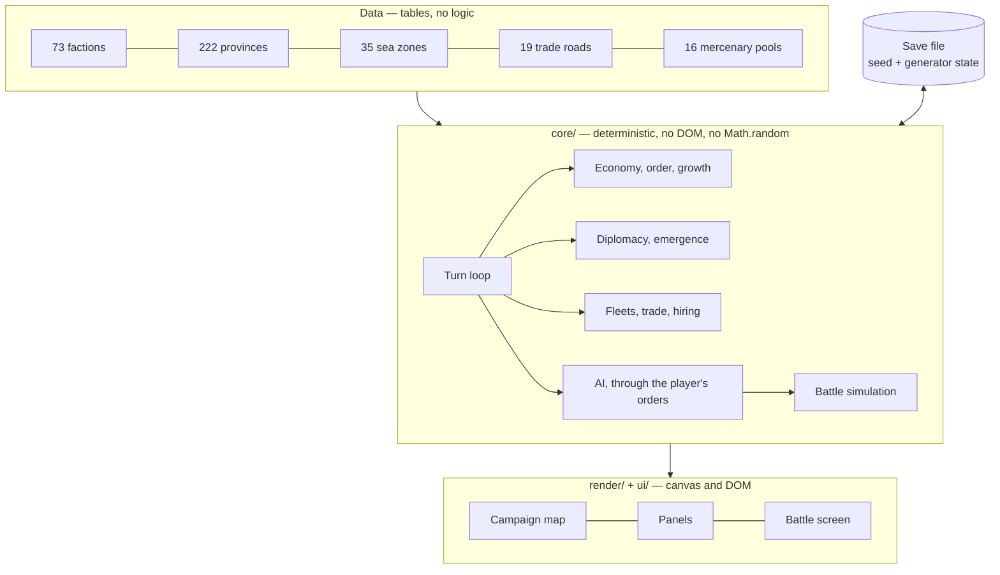

A turn runs a fixed pipeline: the AI acts, sieges progress, provinces build and
muster and grow and settle or revolt, fleets and caravans move, finances settle,
the clock advances, new factions emerge, dead ones are reaped, and every army
and fleet gets its movement back. The order is fixed so that a save taken at any
point replays identically.

## Quick start

Prerequisites: [Node 20+](https://nodejs.org). Nothing else — the game has no
runtime dependencies.

```bash
git clone https://github.com/Hercegman/regna.git
cd regna
npm install
npm run dev          # http://localhost:5173
```

## Playing

A short guide opens with your first campaign: eight things a ruler has to be
able to do, each marked off the moment you do it rather than when you read
about it, in whatever order you like. The **Guide** button puts it away and
brings it back.

Choose a faction, then:

| Action | How |
| :--- | :--- |
| Select a province | click it |
| Order whoever is selected | **right-click** where he should go — march, sail, lay siege |
| Open a province's scroll | double-click it, or **Settlement** on the bottom bar |
| See a sea and the fleets in it | click open water |
| Pan | drag, the arrow keys, the edge of the picture, or click the radar |
| Zoom | scroll, or `+` and `-` |
| Every province name | `L` |
| Every trade road | `T` |
| Put the scroll away | `Esc` |
| End the turn | `Enter` |

In a battle the camera is yours too: scroll to zoom, drag with the right button
to pan, `+` and `-` from the keyboard, `Home` to frame both armies again, or
click the radar to go there. A kilometre and a half of ground and a man a metre
wide do not share a scale, so close in you watch the men and pulled back you
read the shape of the battle.

The band along the bottom is the same one the map has, saying the things a
battle needs said. Your regiments are the cards on the left, each with two bars
rather than one — strength over heart — because a regiment at full strength and
no heart is about to run, and the card goes red when it does and grey when it
is gone. The chosen regiment's wind and shot are in the middle with what it can
be ordered to do; the radar, the speed and **Advance** are on the right.
**Order of battle** unrolls both sides on the scroll.

The bottom bar has whoever is standing where you are looking and what can be
done with him. Everything there is to read — the province, its building,
recruitment and shipbuilding options, the trade roads through it, diplomacy and
the state of the realm — is on the scroll, which the buttons on that bar open
and `Esc` puts away.

- **On land.** Select an army and right-click where it should go. **March**
  highlights everywhere it could reach first, if you would rather see them.
  Moving into a defended enemy province offers battle, which you can fight
  yourself or leave to your captains. A walled settlement has to be stormed or
  starved out.
- **At sea.** Lay down hulls from the **Ships** tab, select the squadron, and
  right-click a water or a harbour. Load an army with **Embark** and put it on
  a hostile coast with **Land at**.
- **On the roads.** The **Trade** tab shows what a caravan would cost and what
  it is expected to fetch, and sends one.
- **For hire.** Companies appear on the province panel wherever any are standing
  about, including in towns you do not own.
- **The house.** The **Realm** tab shows the ruler, the realm's legitimacy,
  the line of rulers before him and who would succeed him if he died today —
  including when that would be a child. Marriage offers are on the
  **Diplomacy** tab, with the odds on the button.
- **Abroad.** The **Agents** tab raises a spy, an envoy, a priest or a factor
  where the institution for him exists, lists everyone you have and everyone
  standing in the province you are looking at, and offers each man the missions
  he could attempt from where he stands, with the odds on the button.
- **The faith.** The **Realm** tab holds your standing with the authority of
  your own faith, the price of absolution if you are under censure, and the
  crusade or jihad now being preached. Taking the vow relieves a quarter of
  your soldiers' upkeep and declares war on whoever holds the place.

**Save** stores the campaign in the browser; **Export** downloads it as a file.
Both are offered again on the faction select screen.

<div align="center">
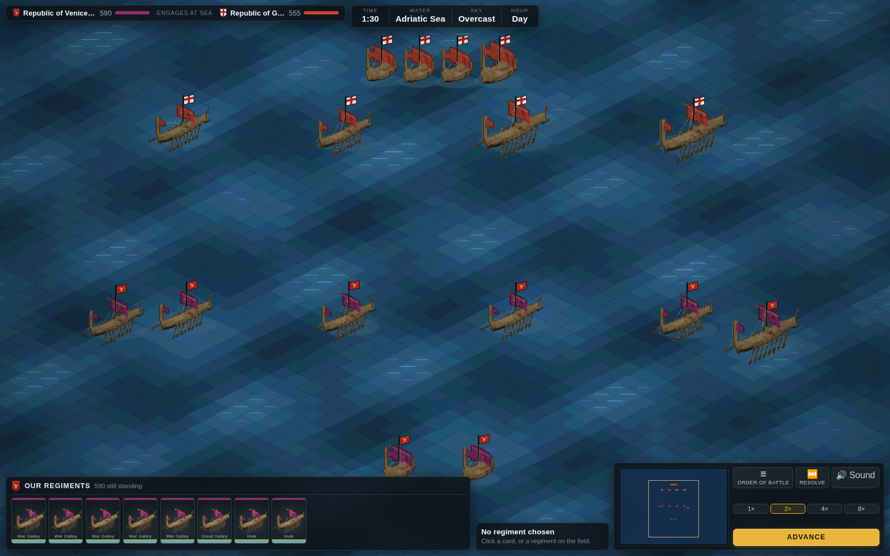
</div>

## Architecture

| Layer | What it does |
| :--- | :--- |
| `src/core/data/` | Factions, units, ships, mercenaries, buildings, provinces, borders, seas, trade roads. Tables, with no logic in them. |
| `src/core/campaign/` | The turn loop, economy, public order, recruitment, diplomacy, faction emergence, the navy, trade, hiring, agents, the court, the AI, and saves. |
| `src/core/battle/` | Deployment, the fixed-timestep simulation, the battle AI and the ground. |
| `src/render/` | The Mercator projection and camera, the province geometry, and the isometric renderer: `iso/` holds the view transform, the elevation, the land mask, the palette and the sprite sheet; `map.ts` and `battle.ts` draw with them. |
| `src/ui/` | Screens, panels, persistence. Plain DOM, no framework. |
| `tools/` | `build-geography.py` for the coastline, `build-elevation.py` for the ground, `build-sprites.py`, which drives Blender to model and render every sprite on the map, and `diagnose.ts`, which plays two centuries with nobody at the wheel and flags the numbers that cannot be right. |
| `src/audio/` | The synthesiser. Web Audio, no files: everything the game makes a noise with is built from noise and oscillators. |
| `tests/` | Tests, including three-hundred-turn runs that assert the simulation never breaks its own rules. |

Nothing in `src/core/` touches the DOM, calls `Math.random`, or knows the map
is drawn at all — which is why both renderers could be replaced without a
single test of the simulation changing. Randomness comes
from a xoshiro128\*\* generator whose state is saved with the campaign, which is
why a reloaded save continues identically to one that was never saved — a
property the tests check by playing both forward fifteen turns and comparing.

### Extending it

Adding a faction is one entry in `factions.ts`, plus one line in
`EMERGENCE_SEATS` if it enters play after 1080. Adding a province is one row in
`regions.ts` and its borders in `adjacency.ts`; if it has a harbour, add it to a
sea zone. The tests will tell you if the result is inconsistent: they assert
that every faction can field melee, ranged, cavalry and siege troops, that the
map is fully reachable, that sea crossings join two harbours, that the island
landmasses are exactly the expected ones, that every harbour has water to sail
into, that every trade road is contiguous, and that a hull is never found in an
army or standing on a town wall.

## Development

```bash
npm test             # vitest
npm run typecheck    # tsc --noEmit, strict
npm run build        # typecheck, then bundle
npm run diagnose     # two hundred turns, and what came out of them
```

Two aids for the part of the work that only an eye can judge. The sprite
sheet is a thousand renders and the better part of an hour, so
`REGNA_SPRITES=spearman_0_0_idle,knight_0_2_fight` builds only those and
writes them to `.sprite-preview.png` instead of over the real sheet, which
turns a change to a model into a twenty-second loop. And `/figures.html`,
served by `npm run dev`, lays every kind of soldier out at the sizes the
battlefield actually draws him at, in two realms' colours, on the colour of
grass — because a shield that reads beautifully in the sheet is two dark
pixels on the field, and the sheet is not where the question is settled.

Node is pinned in `.nvmrc`. Every push runs the first three on GitHub Actions,
checks that the bundle is still split into the chunks it is supposed to be —
a build succeeding is not the same as a build doing what it was asked — and
runs `diagnose` alongside them. Not as a gate, because it does not assert,
but so that the report is on the summary page of every build and a number
that has drifted is visible to anyone who looks.

`npm run diagnose` is not a test and does not assert. It plays the campaign
through, counts the map, the realms, what is under arms and every battle fought
— including the sky, the hour and how it ended — and then flags anything that
cannot be right: a province of a hundred million people, a century with two
battles in it, an alliance between everybody. Those were real faults, and every
one of them was invisible to a unit test, because each is true at any single
step and absurd after two hundred.

URL parameters open a known state without a sequence of clicks:

```
?faction=croatia&turns=60&tab=trade      a campaign already sixty turns in
?faction=venice&look=venice&zoom=40      the map, over a given province, close in
?demo=battle&at=255                      a land battle four minutes in
?demo=battle&at=255&bzoom=3              the same battle, close enough to see the men
?faction=venice&agents=spy,priest        a campaign with a few men already in service
?demo=siege&at=240                       an assault on a walled town
?demo=sea&play=1                         a sea fight, running
?demo=battle&weather=snow&hour=dusk      the same battle, in snow, with the light going
?demo=battle&weather=fog&at=360          fog, and an enemy you cannot see until he is on you
?demo=siege&blook=760,860&bzoom=7        the siege train at the back of a storming army
?demo=siege&at=380&bzoom=5&blook=700,260 an assault going in over a breached wall
?demo=end&faction=croatia                the closing reckoning
```

## Roadmap

- [x] Agents — spies, envoys, priests and merchants
- [x] Dynasties: marriage, legitimacy, and a succession that follows the line
- [x] Mercenary politics: companies that change sides, or take a city instead of a contract
- [x] An opening guide, because the interface is dense and used to say nothing
- [x] Civil war: a disputed succession that produces a rival claimant with an army
- [x] Fog of war, which gives a spy something to sell besides sabotage
- [x] Battles fought in winter, in rain, in fog and at night
- [x] Sound, synthesised rather than sampled
- [x] Siege engines that are drawn as siege engines
- [x] Weather that changes during a battle rather than holding for the day
- [x] Every realm's own device on its men's shields
- [x] Walls that decide an assault, and siege engines that bring them down
- [ ] Sprites for the rest of it: baggage, ports and bridges
- [ ] A winter palette for the campaign map, not only the battlefield

## Not a reimplementation

Regna is written from scratch. It is not a port, a decompilation or a
reimplementation of any existing game: no commercial binary was disassembled,
and no third-party game data, art or text is included. The genre is the
inspiration; the code, the data and the prose are this project's own.

The coastline, the lakes and the rivers come from
[Natural Earth](https://www.naturalearthdata.com) 1:50m; the elevation comes
from [ETOPO](https://www.ncei.noaa.gov/products/etopo-global-relief-model)
(NOAA NCEI), fetched for this one window through their subset service. Both
are in the public domain and carry no attribution requirement. The generators
that clip and reduce them — [`tools/build-geography.py`](tools/build-geography.py)
and [`tools/build-elevation.py`](tools/build-elevation.py) — are here, and
their output is checked in.

Every sprite on the map is modelled and rendered by
[`tools/build-sprites.py`](tools/build-sprites.py), which drives Blender from
a script: no hand-placed vertices, and a town's roofs, walls and church are
decided by the same numbers the game uses. Blender is a build-time tool and is
not part of the game. Everything else drawn on the map is vector work
written for this project.

Historical facts are not copyrightable, and the entire world — the polities, the
settlements, the units, the roads, the dates — is built from them. See
[`docs/history.md`](docs/history.md) for which way every disagreement between the
game and the record was settled, and [`docs/design.md`](docs/design.md) for how
the simulation fits together.

## License

[MIT](LICENSE).
